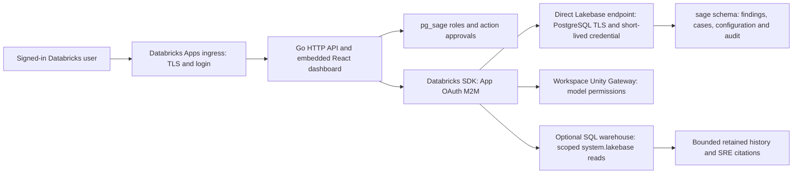

# Databricks-native implementation

pg_sage **2.5.0-dev.10** runs as a local native process against Lakebase or as
a Go service with an embedded React dashboard in Databricks Apps. Lakebase
connections and Unity Gateway AI requests use Databricks OAuth. In Apps,
operators sign in through Databricks only; there is no second pg_sage login or
Gateway API key.

This is a development integration, not a claim of complete Lakebase support.
The October 29–30, 2026 acceptance results establish specific paths and
identities. Public platform documentation was cross-checked November 1, 2026.
The tables below distinguish native-process results from App-principal results
and identify functionality that remains restricted or unproven.

## Start here

| Goal | Guide |
| --- | --- |
| Connect an installed/native binary to an existing Lakebase endpoint | [Lakebase local connection](lakebase.md#local-connection) |
| Configure AI through Unity Gateway | [Gateway configuration and OAuth](lakebase.md#unity-gateway) |
| Build, install, update or troubleshoot the Databricks App | [Databricks Apps operator guide](databricks-apps.md) |
| Understand package files and deployment commands | [Deployment directory README](../deploy/databricks-apps/README.md) |
| Check feature-level support and provider limitations | [Lakebase compatibility matrix](lakebase.md#compatibility-at-a-glance) |
| Review actual delivered behavior and test evidence | [dev.10 acceptance](../reviews/2026-10-30-v2.5-dev10-acceptance.md) and [evidence index below](#validation-and-evidence) |

## Architecture and identity



The runtime remains Go plus embedded React. Python launch/package helpers adapt
that binary to Apps; they do not replace the application or move monitoring
into a notebook or Spark job. The App listens on `DATABRICKS_APP_PORT`, accepts
HTTP/1.1 and H2C behind platform ingress, and leaves external TLS/login to Apps.

Three authorization boundaries remain independent:

1. **Viewer identity:** Apps supplies the signed-in user's forwarded email.
   pg_sage requires platform runtime context, maps that identity to a local role
   and fails closed without identity. `SAGE_DATABRICKS_ADMIN_EMAIL` selects the
   reviewed administrator. Newly created platform users are viewers; visiting
   first does not grant administration. Existing local accounts require reviewed
   identity migration. Access is trusted only behind the Apps ingress; this is
   not a general header-authentication mode for arbitrary proxies.
2. **Background identity:** database, Gateway and warehouse requests use the
   App service principal. These requests do not impersonate the signed-in user
   or inherit their data/model privileges. App mode pins SDK authentication to
   OAuth M2M and rejects PAT/profile/basic fallbacks and configured AI API keys.
3. **Database/action authority:** the PostgreSQL role, object ownership,
   pg_sage role, trust/execution policy, approval and action-specific gates all
   apply. A successful login or resource attachment does not establish every
   database permission or authorize a SQL change.

Locally, select a Databricks CLI profile explicitly. Native database credentials
are minted for physical connections and cached until two minutes before expiry.
Renewal is checked when a new physical connection opens; an established session
can outlive its login token's expiry. OAuth pools verify
the configured endpoint's hostname and use TLS. Use the **direct endpoint**:
Lakebase's built-in pooled endpoint does not support this OAuth path. The
singular endpoint variable affects metadata and monitored pools; use the
documented hostname map when pools target different endpoints.

In Apps, configured AI clients must remain on the exact configured HTTPS
workspace origin. This applies to general/advisor, optimizer and SRE clients,
including persisted overrides and model discovery. Unity Gateway still needs
an allowed model route and the App principal's invocation permission. A model
call proves that model/path, not universal tool or JSON support across models.

## State, resources and configuration

Lakebase stores persistent pg_sage metadata in `sage`: accounts and role
bindings, findings, cases, proposals, configuration, audit and retained history.
Observation mode still bootstraps and writes this metadata; it is not a
zero-write database connection. Start with a dedicated development branch and
database. Reusing an existing endpoint is supported, but does not isolate
cluster-wide effects of arbitrary integration fixtures.

App local storage is ephemeral. The package can recreate the executable and
listen-address configuration. Keep the encryption key in an existing secret
resource, stable across restarts/deployments; preserve and migrate existing
metadata rather than dropping a user-owned `sage` schema to repair ownership.
Packages must not contain database passwords, workspace tokens or raw test data.

| Input or resource | Purpose and boundary |
| --- | --- |
| `postgres` App resource | Existing Lakebase database binding; current template uses `CAN_CONNECT_AND_CREATE`. Verify the resulting role and actual object grants separately |
| `PGHOST`, `PGDATABASE`, optional `PGUSER` | Direct endpoint and actual database role; App launcher defaults the role to injected `DATABRICKS_CLIENT_ID` |
| `SAGE_LAKEBASE_ENDPOINT` | Full `projects/<project>/branches/<branch>/endpoints/<endpoint>` path; native multi-endpoint deployments instead use `SAGE_LAKEBASE_ENDPOINTS` |
| `sage-encryption-key` secret resource | Supplies stable `SAGE_ENCRYPTION_KEY`; do not generate a new key on every boot |
| `SAGE_AUTH_MODE=databricks_app` and `SAGE_DATABRICKS_ADMIN_EMAIL` | Platform-only authentication and explicit administrator selection |
| `gateway-model` resource, Gateway URL and model name | Model invocation authority; `llm.auth=databricks`, no API key |
| Optional `lakebase-history-warehouse` resource | Warehouse `CAN_USE` plus appropriate UC/system-table permissions; does not grant access by itself |
| `lakebase_observability` settings and bindings | Explicit endpoint/database identity, bounds, retention and payload consent for the optional history reader |
| Observation trust, executor/SRE policy and token budgets | Control proposals, mutations, background investigations and AI spend independently |

Use [settings.example.json](../deploy/databricks-apps/settings.example.json),
[configure.py](../deploy/databricks-apps/configure.py),
[app.yaml](../deploy/databricks-apps/app.yaml) and
[databricks.yml](../deploy/databricks-apps/databricks.yml) as portable inputs.
The [operator guide](databricks-apps.md#establish-the-operator-inputs) explains
which values to obtain from the deployed workspace and how to retain the full
resource set when updating an App. CLI/bundle schemas vary: inspect installed
help and validation warnings, including the tested model-resource schema limit.

## Install and operate

For a local build, use Go 1.25+, Node.js 20+ and a C compiler. Install frontend
dependencies, then build with the repository helper:

```bash
npm --prefix sidecar/web ci
bash scripts/build-local.sh
./dist/pg_sage --version
```

The helper retains libpg_query SQL AST validation. Select a profile and a
passwordless, URL-encoded database role; apply the
[Lakebase connection configuration](lakebase.md#local-connection) and
[Gateway configuration](lakebase.md#unity-gateway) before starting the binary.
Standalone UI login remains separate from workspace credentials used for
outbound calls. Platform-only UI sign-in applies to Apps mode.

For Apps, follow the [full build/package sequence](databricks-apps.md#build-and-package)
to produce a Linux artifact matching the runtime architecture with libpg_query
(the recorded dev.10 artifact is AMD64). The
[deployment sequence](databricks-apps.md#install-or-update-an-app) covers:

1. Inventory the existing endpoint/database, App principal, grants, secret,
   Gateway model and optional history warehouse.
2. Package and configure a fresh runtime-only stage using private local settings.
3. Preserve every resource and identity setting when creating/updating the App.
4. Validate the package and upload only the manifest-selected runtime files using
   the documented raw workspace upload procedure; do not sync the repository.
5. Deploy a SNAPSHOT and compare the deployed files/artifact hashes with the
   stage, then check authenticated runtime readiness and, for selected-model
   acceptance, an actual AI call.
6. Retain the previous package, settings and compatible metadata/schema baseline
   for an operator-directed rollback. Redeploying an older binary alone does
   not reverse database migrations or restore a lost encryption key.

The [logs/troubleshooting table](databricks-apps.md#logs-and-troubleshooting)
separates startup/authentication errors, ownership failures, empty telemetry,
Gateway permission issues and stale browser/database state. Profile, workspace,
endpoint mapping and cached provider changes require a process restart.

## What works and where support stops

| Capability | Established behavior | Restriction or unproven path |
| --- | --- | --- |
| Native/App Lakebase connection and metadata | TLS/OAuth, bootstrap, collectors, preview/test helpers and connected App Fleet | Grants and physical identity are per deployment; latest artifact lacks a new hour-boundary/multiday/failover soak |
| Gateway AI | Native calls, tools/advisors and real App OAuth M2M explanation with token use | Model capabilities/permissions vary; no API-key fallback in Apps |
| Deterministic findings | Nine controlled native finding/recovery families; all nine generated App findings | This is not every possible rule or an App-executed remediation proof |
| Memory advice | Hint-free temporary-spill findings and controlled `SET LOCAL work_mem` tests | Aggregate counters have reset/eviction limits; no automatically selected memory value or Lakebase role-wide execution contract |
| SQL changes | Eight enabled native action contracts plus an owned-table statistics-maintenance lifecycle | App-principal workload-table execution remains unproven; observation mode and provider/action gates remain active |
| Ordinary auto_explain | Tested module was preloaded, with default threshold disabled | Tested role cannot set required threshold; pg_sage session/file integration is unavailable |
| Provider plans and historical SRE | Positive controlled native telemetry, all ten streams, five normalized/history adapters; App model-cited history | App raw-payload/cache path unproven; asynchronous, partial history has no complete-delivery or latency proof |
| Application SLO | Scoped native and authenticated App synthetic sample/burn/citation/staleness lifecycle | Needs application counters; logs/ASH do not provide a complete customer-error denominator |
| Hints/HypoPG | Plain EXPLAIN works; real disposable-index experiment is a separate tested alternative | pg_hint_plan hook activation and HypoPG unavailable for tested image/role; telemetry cannot enable them |
| Agent/MCP and signed machine ingestion | Standalone contracts retained | Apps protocols return explicit unsupported status where platform identity cannot preserve the original agent/source grant contract |

The detailed [Lakebase matrix](lakebase.md#compatibility-at-a-glance) identifies
native versus App evidence, versions and failed attempts. Connection probes on
PG16/17 do not extend the broad PG18 test results to those engines.

The nine controlled families were duplicate index, missing foreign-key index,
stale statistics, bloat, heavy sequential scans, invalid index, sequence
exhaustion, slow query at the default threshold and temporary spill. See the
[scenario report](../reviews/2026-10-30-nerdlab-findings.md) for collection,
resolution and retained-fixture details. Invalid-index warmup preserves an
existing finding until sufficient observations can support resolution. Query
IDs stay exact signed 64-bit decimal strings across APIs and the browser.

## Telemetry, auto-explain, SRE and SLOs

Current public Lakebase telemetry documentation describes Beta preview
automatic capture into `system.lakebase` while compute runs; legacy provider
observability configuration objects no longer receive data and cannot be
created. pg_sage's explicit reader bindings select the intended physical
endpoint/database. They are not instructions to create those retired objects.
Warehouse/UC access, project opt-in where applicable, payload consent and
unmasking are separate prerequisites. Follow the
[current platform and reader details](lakebase.md#advanced-telemetry-auto_explain-and-sre-history).

Provider `plan_history` is distinct from installing or controlling ordinary
session auto_explain. With explicit consent, structured payloads can enter the
provider-plan cache; metadata-only operation retains bounded structured
observations and provenance without raw SQL, plans, log bodies or actors.
The native controlled capture proves positive delivery. Earlier zero-row reads
remain dated failures/inconclusive observations, not proof of platform absence
or later complete delivery.

Without Advanced Telemetry, catalog/query-statistics collection and supported
live read-only SRE probes still work within privileges and database-only policy.
Telemetry adds retained plan/log/session/DDL/database observations, cited by the
`read_history` tool. Neither a positive history row nor a readable empty probe
proves the current incident's cause. History is delayed and cannot satisfy live
CPU/I/O admission or establish every lock, connection, WAL or pressure scenario.
See [SRE with and without telemetry](lakebase.md#sre-with-and-without-advanced-telemetry).

Application SLO evaluation requires explicitly bound application counters.
Apps offers administrator-only authenticated sample ingestion with durable
database/objective scope, actor-bound series and replay/conflict checks. Stale
samples become unknown. The synthetic lifecycle is tested; a complete
production customer SLO is not established by that test or by provider logs.

The statistics-maintenance bridge requires a retained investigation, fresh
evidence, exact physical object identity, human approval and the existing typed
executor gates. Native owned-table proposal, execution, structural verification
and rollback were tested. Rollback cannot restore old ANALYZE statistics and
does not prove performance improvement or incident recovery. Separate
coordination-database retention holds are unsupported. Read the
[maintenance contract](lakebase.md#operator-requested-statistics-maintenance)
before changing permissions or execution policy.

## Understanding Cases, Actions and Ask Sage

Cases explain what was observed, the possible consequence, what is missing and
a supported next step. Technical evidence remains expandable. Unknown urgency,
size, impact and recovery are shown as unknown; absence of a measurement is not
a successful safety check. Suppression hides a condition rather than fixing it.

Actions separates **Proposed changes**, **Needs your review**, **In progress**
and **History**. An accepted approval, completed SQL and a verified outcome are
different facts. Execution mode is separate from operational risk. Equivalent
action aliases consolidate into one review item, while saved proposals retain
their own risk/recovery claims. Old recovery SQL is withheld when it does not
match the current procedure; unnamed indexes do not receive guessed inverses.
Lakebase-inapplicable system-setting procedures are withheld.

Cases → Actions → Ask preserves database/case context. Explain prepares a draft
for the user to send; it does not automatically start an AI request. A single
running database is selected automatically, and loading/error/empty states are
distinct. Fleet includes actual running/configured databases. The observatory
theme is responsive, with compact original DBA memes on each page and monitoring
scope/mode context before the content.

These changes address heuristic usability findings. Actual novice usability
testing and explicit synthetic-fixture labels in Cases remain outstanding; the
UI does not infer that arbitrary schemas are synthetic from their names.

## Validation and evidence

| Revision | Evidence and limits |
| --- | --- |
| dev.5 | [Latest uninterrupted whole-repository run](../reviews/2026-10-30-v2.5-dev5-acceptance.md): 142 packages, 16,394 passing test/subtest events, 55 allowed skips, 141 package passes and one without tests. Native Lakebase: 79 pass, two explicit skips. Controlled telemetry: 24 records across all ten streams. Separate App/history/SLO acceptance |
| dev.8 | [Scenario/restart acceptance](../reviews/2026-10-30-v2.5-dev8-acceptance.md): 627 analyzer race/integration/e2e tests/subtests; nine controlled finding families and invalid-index restart continuity |
| dev.10 | [Current acceptance](../reviews/2026-10-30-v2.5-dev10-acceptance.md): 726 frontend tests/102 files; 46 browser tests including 22 desktop/mobile routes; 1,434 API/Cases race passes plus one opt-in live skip; lint/build and actual App auth/Gateway/Fleet/context/mobile checks |

The whole-repository result is **dev.5**, not a new dev.10 whole-repository run.
The final dev.10 App SNAPSHOT is `01f1d4c0a6af15be95fc0632b1a607e1`; the
acceptance report retains exact macOS/Linux artifact hashes and its source
fingerprint scope. This documentation publication changes guides, packaging
exclusions, the portable fixture helper and test-only credential setup; it does not rebuild/redeploy that
runtime or re-label its acceptance.

Publication checks on November 1 passed all 22 existing Python packaging tests,
325 relative links/anchors across 35 changed/new Markdown files, whitespace
checks and fixture-helper configuration/refusal checks. Mocked helper checks
verified that an endpoint-host mismatch is refused before minting a credential
or invoking SQL. The native-auth race package also passed after its fixture URL
was made passwordless while preserving the bootstrap-credential check.
No new live workload or compatibility soak was run for this
documentation follow-up.

Additional evidence:

- [Native SQL/action tests](../reviews/2026-10-29-lakebase-native-tests.md)
- [Native and App SRE source matrix](../reviews/2026-10-30-native-sre-source-matrix.md)
- [Provider compatibility failures and alternatives](../reviews/2026-10-30-provider-compatibility-gaps.md)
- [Application SLO acceptance](../reviews/2026-10-30-app-slo-acceptance.md)
- [Statistics-maintenance acceptance](../reviews/2026-10-30-sre-maintenance.md)
- [First-time-user review](../reviews/2026-10-30-first-time-user-ux-review.md) and [dev.9 delivery](../reviews/2026-10-30-v2.5-dev9-acceptance.md)

Reports preserve failures and the scope of later fixes. Private credentials,
screenshots/raw evidence, internal research and workspace/endpoint/principal identifiers are
excluded from the public repository; reviewed reports retain outcomes and hashes.

## Reproduce safely and track remaining work

Run ordinary local integration suites against disposable PostgreSQL. Their
role changes, shared-statistics resets and instance-setting attempts are not a
portable Lakebase full-suite recipe. The
[dedicated Lakebase checks](lakebase.md#reproduce-live-read-only-checks) document
explicit opt-ins and native targets. Packaging can be checked without a workspace:

```bash
python3 -m unittest discover -s deploy/databricks-apps -p 'test_*.py' -v
```

The optional [controlled fixture helper](../scripts/lakebase-nerdlab.py) requires
an explicit profile, endpoint, direct host, database and user, through CLI flags
or `SAGE_NERDLAB_*`. Run `--help` first. It manages only `nerdlab_20261030`, keeps
an exact-identity/object ledger under private `.local-test-results/`, refuses
reuse or changed inventory and enforces a cumulative 110-scan budget. Keep the
same manifest between commands; do not delete it to repeat an exhausted budget.
`seed`, `exercise`, `slow-query` and `cleanup` intentionally change the selected
development database. `preflight` inspects identity, while `status` verifies the
ledger and reads findings. No fixture command runs automatically during deployment.

Remaining compatibility work includes App-principal workload-table maintenance,
App raw plan-cache ingestion, latest-artifact credential endurance, multiday and
failover behavior, most sustained incident/pressure families, complete provider
delivery/latency guarantees and real novice comprehension. Provider restrictions
on hints/HypoPG and unsupported Apps agent protocols remain explicit. Measure
each item on an isolated authorized target; retain an incompatibility when no
supported workaround satisfies the original contract.

## Implementation map

| Area | Source |
| --- | --- |
| Unified authentication and Lakebase pools | [databricksauth](../sidecar/internal/databricksauth/) |
| Platform viewer identity and API policy | [App auth](../sidecar/internal/auth/databricks_app.go), [API boundary](../sidecar/internal/api/databricks_app_auth.go), [AI policy](../sidecar/internal/config/databricks_policy.go) |
| Deployment diagnostics | [Safe deployment status](../sidecar/internal/api/deployment_status.go) |
| Telemetry and provider plans | [lakebaseobs](../sidecar/internal/lakebaseobs/), [reader configuration](../sidecar/internal/config/lakebase_observability.go), [provider-plan adapter](../sidecar/internal/autoexplain/provider_plan.go) |
| Historical SRE and maintenance | [Historical probes](../sidecar/internal/sre/probes/historical.go), [causal history](../sidecar/internal/sre/causal/historical.go), [maintenance](../sidecar/internal/sre/action/maintenance.go) |
| App SLI ingestion | [Scoped authenticated handler](../sidecar/internal/api/sre_app_sli.go) |
| Case recovery/provider guidance | [Recovery](../sidecar/internal/cases/recovery.go), [applicability](../sidecar/internal/cases/provider_applicability.go) |
| UI context and presentation | [MonitoringContext](../sidecar/web/src/components/MonitoringContext.jsx), [case presentation](../sidecar/web/src/pages/cases/casePresentation.js), [action workflow](../sidecar/web/src/pages/actions/workflow.js), [memes](../sidecar/web/src/components/PostgresMeme.jsx) |

## Public platform references

- [Databricks Apps runtime](https://docs.databricks.com/aws/en/dev-tools/databricks-apps/app-runtime)
- [Injected environment](https://docs.databricks.com/aws/en/dev-tools/databricks-apps/system-env)
- [Forwarded identity headers](https://docs.databricks.com/aws/en/dev-tools/databricks-apps/http-headers)
- [Lakebase Apps tutorial](https://docs.databricks.com/aws/en/oltp/projects/tutorial-databricks-apps-autoscaling)
- [Lakebase telemetry reference](https://docs.databricks.com/aws/en/oltp/projects/observability-telemetry-reference)
- [Lakebase extensions](https://docs.databricks.com/aws/en/oltp/projects/extensions)

Public references and deployed behavior define current support. Dated test
observations can differ from later platform catalogs; the detailed Lakebase
guide calls out those boundaries rather than treating a catalog listing as
proof that a module's required session hooks work.
